# Handleiding LMC-capaciteit

> Dit overzicht is bedoeld voor capaciteitsplanning en een eerlijke werkverdeling. Het is geen middel om prestaties te beoordelen.

De app laat zien wie ruimte heeft voor een nieuwe school, een project of een incidentele activiteit, en hoe de planning zich verhoudt tot wat in MATT is geboekt. Je gebruikt hem op een laptop of tablet, in een actuele browser met JavaScript aan.

_Alle schermafbeeldingen in deze handleiding tonen **fictieve gegevens** uit de demomodus. Het zijn geen echte medewerkers of uren._

**Inhoud:** [Inloggen](#1-eerste-keer-inloggen) · [Indeling](#2-indeling-van-de-app) · [Mijn belasting](#3-mijn-belasting) · [Gepland en gerealiseerd](#4-gepland-en-gerealiseerd) · [Teamoverzicht](#5-teamoverzicht) · [Beheer](#6-beheer) · [Toewijzingen](#7-toewijzingen) · [MATT-import](#8-matt-import) · [Accounts](#9-accounts) · [Toegankelijkheid](#10-toegankelijkheid) · [Privacy](#11-privacy) · [Woordenlijst](#12-woordenlijst)

## 1. Eerste keer inloggen

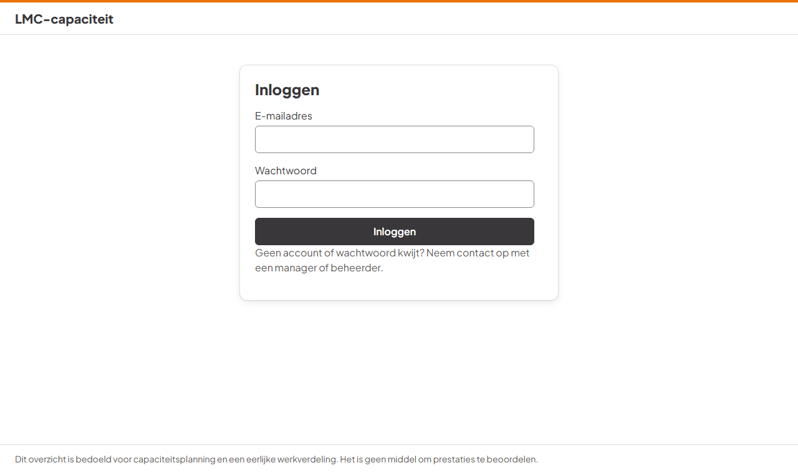

1. Een manager of beheerder geeft je je e-mailadres en een **tijdelijk wachtwoord**.
2. Log in. De app vraagt je een **eigen wachtwoord** te kiezen van minstens 12 tekens. Een zin werkt goed, bijvoorbeeld _drie boeken op de plank_.
3. Koppel een **authenticator-app** op je telefoon, zoals Microsoft Authenticator of Google Authenticator. Scan de QR-code, of typ de sleutel over, en vul de code van 6 cijfers in.
4. Klaar. Voortaan log je in met je e-mailadres, je wachtwoord en een code uit de app.

**Tweede toestel:** onder **Beveiliging** koppel je een tweede telefoon of tablet. Dat is handig als je je telefoon kwijtraakt.

**Telefoon kwijt of wachtwoord vergeten?** Er is geen herstel per e-mail. Vraag een manager of beheerder om je account te **resetten**. Je krijgt dan een nieuw tijdelijk wachtwoord en koppelt opnieuw een authenticator-app.

Na 30 minuten zonder activiteit word je automatisch uitgelogd.

## 2. Indeling van de app

- **Links het menu**, in groepen: _Overzichten_, _Beheer en import_ en _Jouw account_. Je ziet alleen wat bij je rol hoort. Op een tablet staat het menu bovenaan achter de knop **Menu**.
- **Rechts de inhoud.** Bovenaan staat de titel van de pagina; in Beheer zie je ook waar je bent, bijvoorbeeld _Beheer › Scholen_.
- **Onderaan** staat altijd de vaste tekst over het doel van de app.
- **Schooljaar:** op pagina's met gegevens per schooljaar kies je het schooljaar. Je keuze blijft staan als je naar een andere pagina gaat. Na opnieuw inloggen begint de app weer bij het huidige schooljaar.

## 3. Mijn belasting

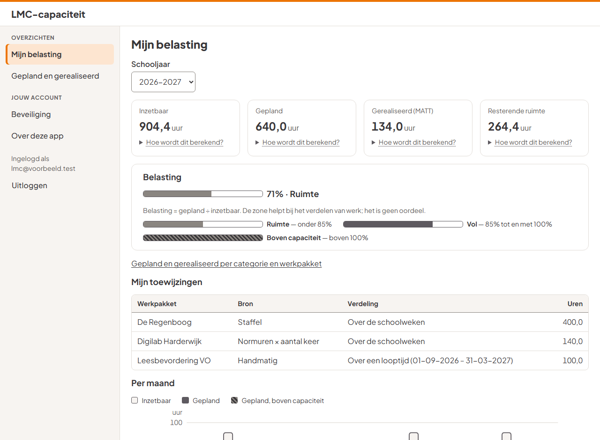

Voor het gekozen schooljaar zie je vier getallen. Onder elk getal staat **Hoe wordt dit berekend?**; klik erop voor de uitleg.

| Getal                   | Betekenis                                                                                                |
| ----------------------- | -------------------------------------------------------------------------------------------------------- |
| **Inzetbaar**           | Je contracturen op werkdagen, min feestdagen, minder beschikbaarheid, vakantie-uren en overhead          |
| **Gepland**             | Alle uren uit je toewijzingen: scholen (staffel × opslag), activiteiten (normuren × aantal) en projecten |
| **Gerealiseerd (MATT)** | Uren die in MATT zijn geboekt (alleen definitieve imports)                                               |
| **Resterende ruimte**   | Inzetbaar min gepland. Een negatief getal betekent dat er meer gepland is dan er inzetbaar is            |

Onder **Belasting** staat gepland gedeeld door inzetbaar, met een zone. De zone is altijd een woord met een grijze balk; er zijn geen kleuren die iets beoordelen.

| Zone                | Betekenis                       | Balk                  |
| ------------------- | ------------------------------- | --------------------- |
| Ruimte              | onder 85%                       | lichtgrijs, deels vol |
| Vol                 | 85% tot en met 100%             | donkergrijs           |
| Boven capaciteit    | boven 100%                      | gearceerd             |
| Geen inzetbare uren | in dit schooljaar geen contract | leeg                  |

De grenzen zijn instellingen. Ze kunnen per datum veranderen; de app gebruikt de grenzen die gelden aan het begin van het schooljaar.

Daaronder staan je **toewijzingen** en een grafiek **per maand**:

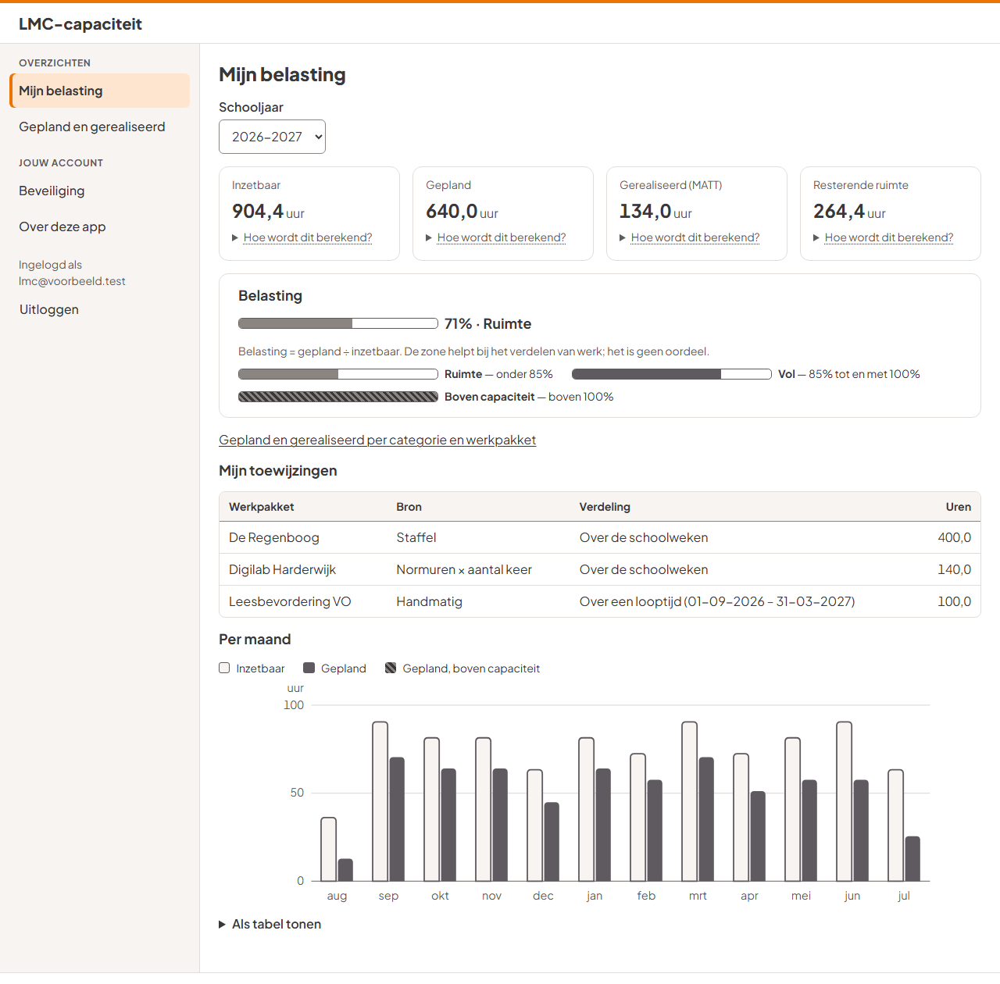

- De **omlijnde staaf** is inzetbaar, de **gevulde staaf** is gepland. Een **gearceerde** staaf betekent: in die maand boven capaciteit.
- Ga met de muis over een maand voor de precieze getallen.
- Onder **Als tabel tonen** staan dezelfde getallen als tabel.

## 4. Gepland en gerealiseerd

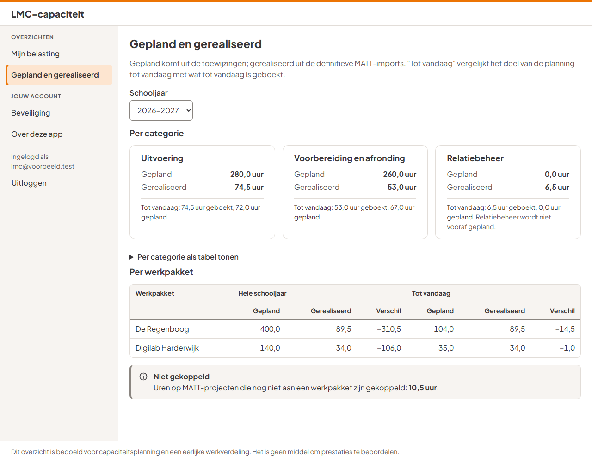

Hier vergelijk je de planning met MATT:

- **Per categorie:** uitvoering, voorbereiding en afronding, en relatiebeheer. Per categorie zie je _gepland_, _gerealiseerd_ en **tot vandaag**: hoeveel uur er tot vandaag is geboekt en hoeveel er tot vandaag was gepland. Relatiebeheer wordt niet vooraf gepland, alleen geboekt.
- **Per werkpakket:** de school, activiteit of het project waarop de uren zijn gepland en geboekt, met het verschil.
- **Niet gekoppeld:** uren op MATT-projecten die nog niet aan een werkpakket hangen. Wie mag beheren, ziet een link om ze te koppelen.

Een verschil is geen oordeel. Planning en werkelijkheid lopen in de loop van het jaar vaak uiteen.

## 5. Teamoverzicht

_Voor coördinatoren, managers en beheerders._

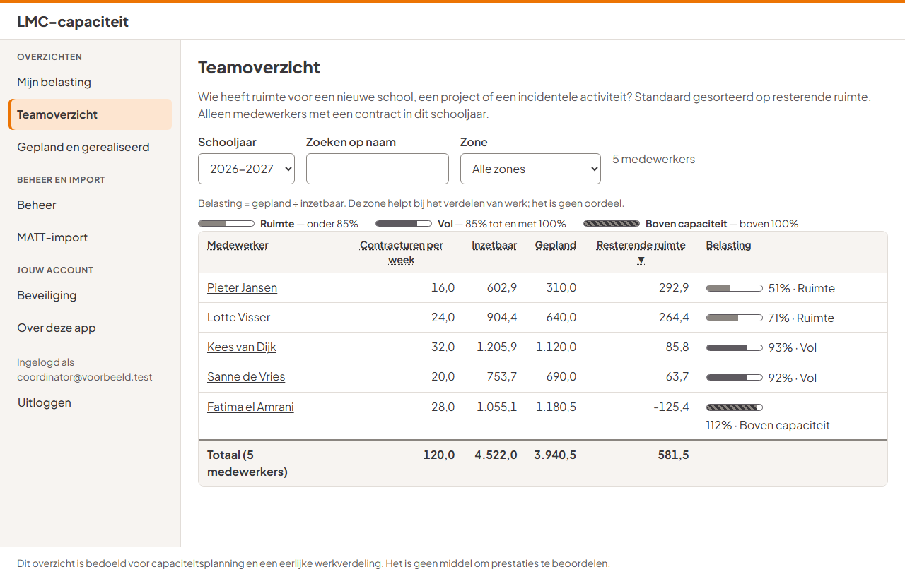

- Per medewerker de contracturen, inzetbaar, gepland, resterende ruimte en de belasting. Standaard staat bovenaan wie de meeste ruimte heeft.
- **Sorteren:** klik op een kolomkop.
- **Zoeken op naam** en **filteren op zone**; boven de tabel zie je hoeveel medewerkers er getoond worden.
- De **totaalrij** telt de getoonde medewerkers op: handig voor de planning van het hele team.
- Klik op een naam om **gepland en gerealiseerd** van die medewerker te zien. Met het kruimelpad _Teamoverzicht › naam_ ga je terug.
- Alleen medewerkers met een contract in het schooljaar staan erin.

Op een tablet staand zie je een kaart per medewerker:

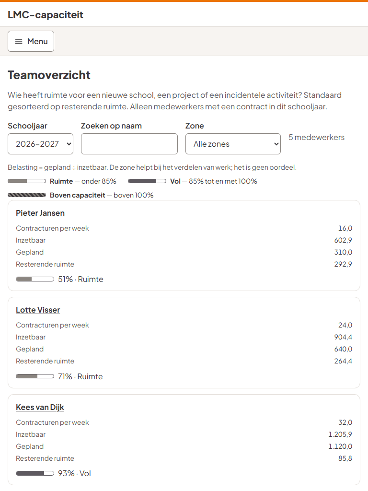

## 6. Beheer

_Voor coördinatoren, managers en beheerders._

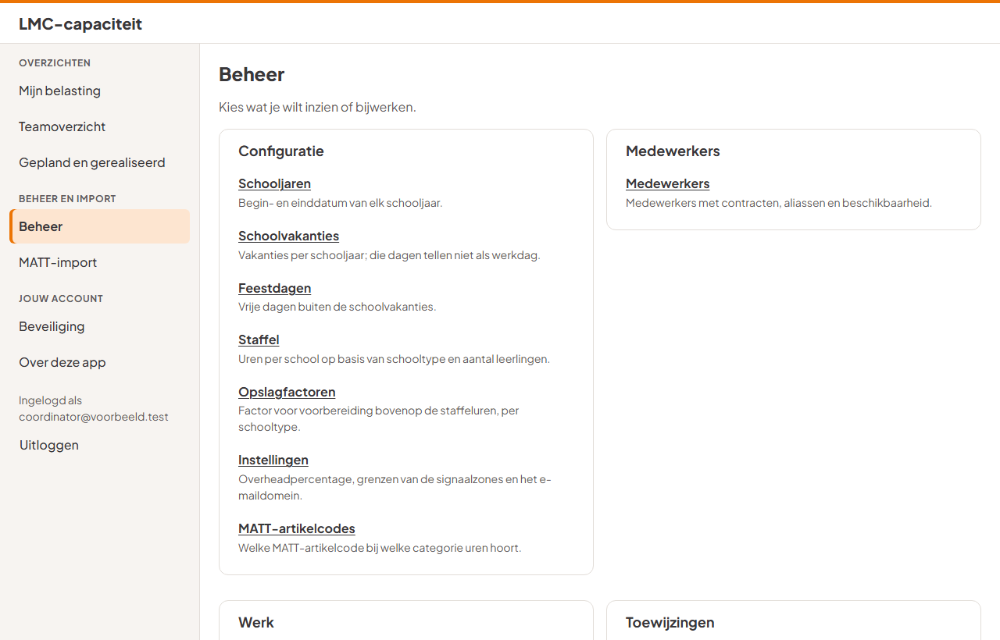

Onder **Beheer** staat per groep wat je kunt inzien of bijwerken, met een korte uitleg:

- **Configuratie:** schooljaren, schoolvakanties, feestdagen, staffel, opslagfactoren, instellingen (overhead en grenzen, met ingangsdatum) en MATT-artikelcodes.
  - **Nieuw schooljaar:** maak het schooljaar aan en gebruik bij Schooljaren het blok _Configuratie overnemen uit een ander schooljaar_ (knop **Overnemen**). Dat kopieert de staffel, de opslagfactoren (opnieuw "nog te bevestigen") en de schoolvakanties. Controleer daarna de vakantiedatums. Toewijzingen worden niet gekopieerd.
- **Medewerkers:** gegevens, contracten, vakantie-uren (per kalenderjaar, van HR), beschikbaarheid en aliassen. Bij een medewerker wissel je met de tabbladen; met de pijltjestoetsen gaat dat ook.
  - **Beschikbaarheid:** leg alleen het percentage vast, **nooit een reden**.
  - **Medewerker vertrekt:** zet de medewerker op _niet actief_. De toegang tot de app vervalt dan direct.
- **Werk:** scholen, leerlingen per schooljaar, activiteittypes, activiteiten, projecten en MATT-projecten.
- **Toewijzingen:** zie hoofdstuk 7.

**Zo werkt elk beheerscherm:**

1. Bovenaan staan zoeken, het aantal regels en de knop **… toevoegen**.
2. **Bewerken** of **Toevoegen** opent rechts een **paneel**. De lijst blijft staan.
3. Klik op **Opslaan**. Rechtsonder verschijnt kort een bevestiging.
4. Klopt er iets niet, dan staat bovenaan het paneel een overzicht. Klik op een regel daarin om naar het veld te gaan.
5. Sluit je het paneel met wijzigingen die nog niet zijn opgeslagen, dan vraagt de app eerst of ze weg mogen.
6. **Verwijderen** vraagt altijd om bevestiging en zegt wat er verdwijnt.

**Alleen inzien:** heb je geen recht om iets te wijzigen, dan staat er bovenaan _Je kunt dit onderdeel inzien. Wijzigen kan een coördinator of manager._ De velden zijn dan gestippeld en het paneel heet _Bekijken_. De beheerder kan het werk en de toewijzingen alleen inzien.

## 7. Toewijzingen

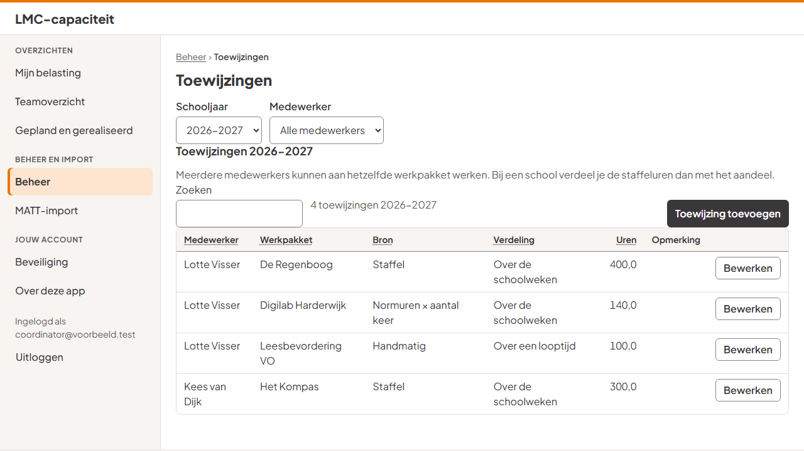

Een toewijzing zegt wie welk werkpakket doet, met hoeveel uren en welke verdeling. Het formulier staat in blokken: **Wie en wat**, **Uren** en **Verdeling**.

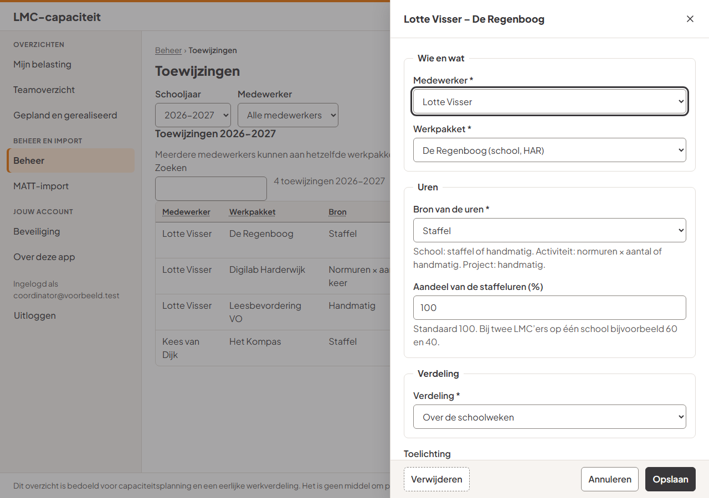

| Soort werkpakket | Bron van de uren                                                                 |
| ---------------- | -------------------------------------------------------------------------------- |
| School           | staffel, met een aandeel bij meerdere LMC'ers (bijvoorbeeld 60/40), of handmatig |
| Activiteit       | normuren × aantal keer, of handmatig                                             |
| Project          | handmatig: uren per categorie                                                    |

Onderaan het paneel staat **Wat levert dit op?**: de app rekent uit hoeveel uur de toewijzing oplevert en over hoeveel dagen die worden verdeeld, bijvoorbeeld _≈ 400,0 uur, verdeeld over 186 schoolweekdagen_. Dat is dezelfde berekening als in de planning; er wordt nog niets opgeslagen.

Een opmerking in de lijst verschijnt als de aandelen van een school samen niet op 100% uitkomen.

## 8. MATT-import

_Voor coördinatoren, managers en beheerders._ De import gaat in drie stappen.

**Stap 1 · Bestand en periode**

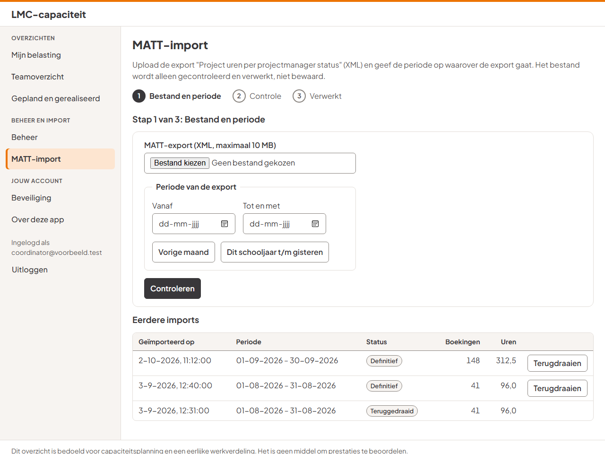

1. Exporteer in MATT het rapport _Project uren per projectmanager status_ als **XML**.
2. Kies het bestand. Je ziet de naam en de grootte.
3. Vul de **periode** in waarover de export gaat, of gebruik **Vorige maand** of **Dit schooljaar t/m gisteren**.
4. Klik op **Controleren**.

**Stap 2 · Controle**

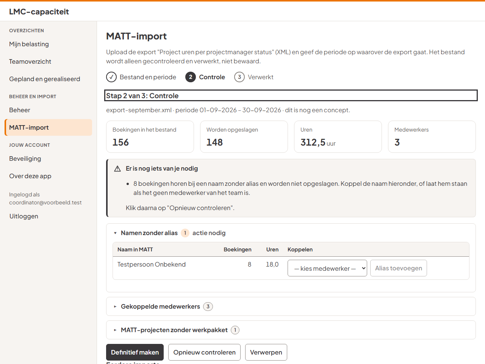

- Bovenaan staan de aantallen: boekingen in het bestand, hoeveel er worden opgeslagen, de uren en het aantal medewerkers.
- **Er is nog iets van je nodig** verschijnt als er:
  - **namen zonder alias** zijn: die boekingen worden niet opgeslagen. Koppel de naam aan een medewerker met **Alias toevoegen**, of laat hem staan als het geen medewerker van het team is;
  - **artikelcodes zonder categorie** zijn: vul ze aan bij Beheer › MATT-artikelcodes.
- Klik daarna op **Opnieuw controleren**.
- **MATT-projecten zonder werkpakket** zijn informatie, geen actie: de boekingen worden wel opgeslagen. Koppel ze later bij Beheer › MATT-projecten.
- Klik op **Definitief maken** en bevestig. Bestaande boekingen van dezelfde medewerkers in die periode worden vervangen. Twee keer hetzelfde bestand importeren geeft dus geen dubbele uren.

**Stap 3 · Verwerkt**

Je ziet hoeveel boekingen zijn verwerkt, met links naar de overzichten. Met **Nieuwe import** begin je opnieuw.

**Eerdere imports:** een definitieve import kun je **terugdraaien**. De boekingen worden dan verwijderd. Wat die import eerder had vervangen, komt niet terug: importeer die periode zo nodig opnieuw.

Het bestand zelf wordt niet bewaard.

## 9. Accounts

_Voor managers en beheerders._

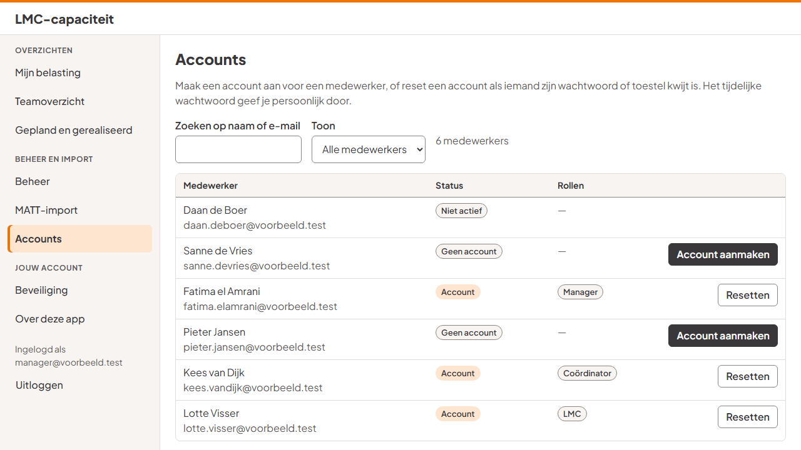

- Zoek op naam of e-mail, en filter op _met account_, _zonder account_ of _niet actief_.
- **Account aanmaken:** klik bij een medewerker zonder account op **Account aanmaken**, vink in het venster minstens één rol aan en bevestig. Alleen een beheerder kan de rol beheerder toekennen.
- **Account resetten:** verwijdert alle gekoppelde toestellen en geeft een nieuw tijdelijk wachtwoord. Je eigen account kun je niet resetten; vraag dat aan een collega-manager of -beheerder.

Daarna zie je het **tijdelijke wachtwoord**:

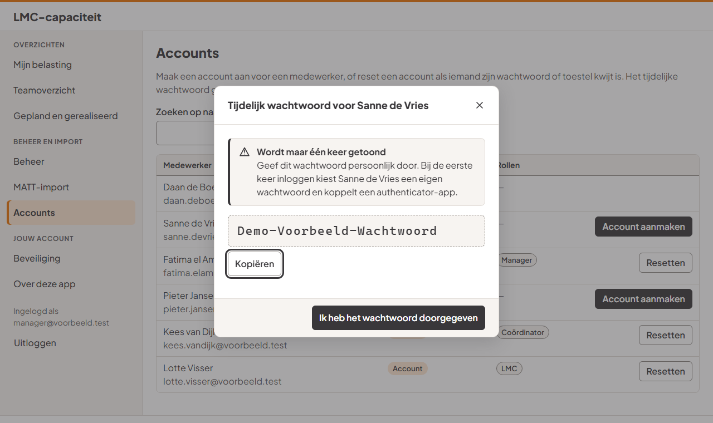

- Het wachtwoord wordt **maar één keer** getoond. Geef het persoonlijk door.
- **Kopiëren** zet het op het klembord; lukt dat niet, dan is de tekst geselecteerd en gebruik je Ctrl+C.
- Sluit met **Ik heb het wachtwoord doorgegeven**. Sluit je op een andere manier, dan vraagt de app eerst of dat mag, want daarna is het wachtwoord weg.

## 10. Toegankelijkheid

- **Toetsenbord:** alles werkt zonder muis. Met Tab ga je naar het volgende onderdeel; de focus is altijd zichtbaar. De eerste Tab biedt **Naar de inhoud** aan. Escape sluit een paneel of venster. In tabbladen gebruik je de pijltjes.
- **Zoom:** de app werkt tot 400% zoom en op smalle schermen; brede tabellen scrollen dan binnen hun eigen vak.
- **Donkere modus:** de app volgt de instelling van je apparaat.
- **Hoogcontrast:** in de contrastthema's van Windows blijven balken, grafiek en stappen zichtbaar.
- **Schermlezers:** pagina's hebben een titel, koppen en vaste gebieden (menu, inhoud). Meldingen worden voorgelezen.

## 11. Privacy

- Je ziet altijd je eigen gegevens. Coördinatoren, managers en beheerders zien de belasting van het team.
- De omschrijvingen van je MATT-boekingen ziet alleen jij. Een coördinator of beheerder kan ze opvragen als dat nodig is, en dat wordt vastgelegd.
- Bij minder beschikbaarheid staat alleen een percentage, nooit een reden.
- Elke wijziging komt in een logboek.
- Zie ook de pagina **Over deze app**.

## 12. Woordenlijst

| Woord                 | Betekenis                                                                                            |
| --------------------- | ---------------------------------------------------------------------------------------------------- |
| **Inzetbaar**         | De uren die je in een periode kunt werken aan werkpakketten (na feestdagen, vakantie en overhead)    |
| **Gepland**           | De uren uit je toewijzingen                                                                          |
| **Gerealiseerd**      | De uren die in MATT zijn geboekt                                                                     |
| **Resterende ruimte** | Inzetbaar min gepland                                                                                |
| **Belasting**         | Gepland gedeeld door inzetbaar, in procenten                                                         |
| **Zone**              | Ruimte, vol of boven capaciteit: een hulpmiddel om werk te verdelen, geen oordeel                    |
| **Werkpakket**        | Een school, activiteit of project waaraan uren worden toegewezen                                     |
| **Toewijzing**        | Wie welk werkpakket doet, met hoeveel uren en welke verdeling                                        |
| **Staffel**           | Uren per school op basis van schooltype en aantal leerlingen                                         |
| **Opslagfactor**      | Factor bovenop de staffeluren voor voorbereiding                                                     |
| **Normuren**          | Uren per keer voor een soort activiteit (uitvoering, voorbereiding, afronding)                       |
| **Verdeling**         | Hoe de uren over het jaar worden verdeeld: over de schoolweken, over een looptijd of op vaste datums |
| **Alias**             | Een andere schrijfwijze van een naam (bijvoorbeeld in MATT) die bij een medewerker hoort             |
| **Concept**           | Een import die gecontroleerd is maar nog niet definitief                                             |
